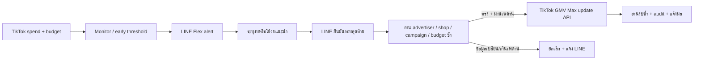

# LIVE GMV Max Budget Guard

ระบบ MVP สำหรับเฝ้าระวังงบ TikTok Shop LIVE GMV Max, ขออนุมัติผ่าน LINE และแก้ daily budget ผ่าน TikTok API for Business โดยตรง

สถานะปัจจุบัน: LINE control plane, backend รับ Chrome telemetry แบบ signed/read-only และ MV3 extension สำหรับอ่านหน้า TikTok พร้อมทดสอบแล้ว ค่าเริ่มต้น **ยังไม่อนุญาตให้ monitor หรือแก้งบจริง** จนกว่าจะ deploy, enroll และผ่านการตรวจ snapshot จริง

## Flow



ระบบรองรับหลายลูกค้าโดยแยก config และสิทธิ์ผู้อนุมัติรายลูกค้า สำหรับแคมเปญคงที่จะ map ดังนี้:

`client → advertiser_id → store_id → LIVE GMV Max campaign_id → LINE approver identities`

สำหรับแคมเปญ LIVE ที่ TikTok สร้างใหม่ทุกวัน ระบบรองรับ dynamic selector:

`client → Chrome profile + tab group → Business Center + advertiser_id → TikTok account ID → Active LIVE GMV Max ของวันนั้น`

หน้า Chrome ไม่เปิดเผย campaign ID ของแถว LIVE จึงเก็บ `campaignId=null` และใช้ `campaignRef` ที่ hash จาก advertiser + ชื่อแคมเปญแทน ห้ามเดา ID; ขั้น API execution ในอนาคตต้อง resolve ID จริงและยืนยันว่าแคมเปญตรงเพียงหนึ่งรายการอีกครั้ง

client แบบ `observe-and-pin` ไม่ต้องให้ผู้ใช้กรอก Store ID หรือเปิด Seller Center ระบบจะอ่าน Shop identity จาก campaign detail เมื่อมี TikTok API แล้วและ pin ค่าไว้ภายใน; Shop context ยังไม่ถูกละทิ้งจากการตรวจ API

ก่อนแจ้งเตือนและก่อนเขียนงบ ระบบจะ resolve แคมเปญอีกครั้ง หากไม่พบ, พบมากกว่าหนึ่งรายการ หรือยืนยัน TikTok account ไม่ได้ ระบบจะหยุดแบบ fail-closed

ข้อความ LINE ไม่สามารถเลือกหรือเปลี่ยน advertiser ID เองได้ จึงไม่เสี่ยงสลับบัญชีจากการพิมพ์ชื่อใกล้เคียงกัน

MVP ใช้ agency OAuth token เดียวได้เมื่อ advertiser IDs ทุกบัญชีอยู่ใน grant เดียวกัน และจะ validate ทุก mapping ตอน start หาก `/oauth2/advertiser/get/` แสดงสิทธิ์ไม่ครบ ต้องทำ OAuth grant เพิ่มและเพิ่ม token routing ต่อ advertiser ก่อนเปิด production; สิทธิ์ที่เห็นในหน้าเว็บเพียงอย่างเดียวไม่ถือว่า API ได้สิทธิ์แล้ว

## สิ่งที่ต้องมี

1. LINE Official Account และ Messaging API channel
2. TikTok API for Business developer app ก่อนเปิด API monitoring/write พร้อม permission:
   - `Ads Management > Campaign > Read Campaigns`
   - `Ads Management > Campaign > Create and Update Campaigns`
   - `Reporting > GMV MAX Report`
   - GMV Max Store/Exclusive Authorization permissions หากต้องการ onboarding ร้านผ่าน API
3. TikTok access token ที่ authorize advertiser IDs ของลูกค้าแล้ว (ยังไม่ต้องมีสำหรับ LINE control plane)
4. Public HTTPS URL สำหรับ LINE webhook
5. Node.js 22.5+ และ persistent storage สำหรับ SQLite

เอกสารทางการที่โค้ดนี้อ้างอิง:

- [Update a GMV Max Campaign](https://business-api.tiktok.com/portal/docs/update-a-gmv-max-campaign/v1.3)
- [Get the details of a GMV Max Campaign](https://business-api.tiktok.com/portal/docs/get-the-details-of-a-gmv-max-campaign/v1.3)
- [Get GMV Max Campaigns](https://business-api.tiktok.com/portal/docs/get-gmv-max-campaigns/v1.3)
- [Metrics in GMV Max Campaign reports](https://business-api.tiktok.com/portal/docs?id=1824722485971009)
- [TikTok API for Business authorization](https://business-api.tiktok.com/portal/docs?id=1738373141733378)
- [Receive LINE webhooks](https://developers.line.biz/en/docs/messaging-api/receiving-messages/)
- [Verify LINE webhook signatures](https://developers.line.biz/en/docs/messaging-api/verify-webhook-signature/)
- [Retry LINE Messaging API requests safely](https://developers.line.biz/en/docs/messaging-api/retrying-api-request/)

## เริ่มต้นแบบปลอดภัย

```bash
cp config/clients.example.json config/clients.json
cp .env.example .env
npm test
```

แก้ `config/clients.json` ด้วย ID จริง แล้ว export ค่าใน `.env` เข้า environment ของเครื่อง/hosting (โปรเจกต์นี้ไม่โหลด `.env` อัตโนมัติ เพื่อลดโอกาส secret รั่วจาก dependency หรือ log)

หากยังไม่มี TikTok Developer App ให้เริ่มเฉพาะ LINE control plane:

```bash
export CONTROL_PLANE_ONLY=true
export EXECUTION_ENABLED=false
export MONITOR_ENABLED=false
npm start
```

โหมดนี้รับ LINE webhook, health check และ one-time pairing ได้ แต่ `/admin/poll` และ `/admin/requests` จะตอบ `503 CONTROL_PLANE_ONLY`; จึงไม่มีทางอ่านหรือแก้งบโดยบังเอิญก่อน Chrome/API adapter พร้อม

เมื่อมี TikTok credentials และ client แบบ API แล้วจึงเริ่มระบบในโหมด dry run:

```bash
set -a
source .env
set +a
npm start
```

ต้องมี public HTTPS host ก่อนจึงตั้ง LINE webhook URL เป็น:

```text
https://YOUR_PUBLIC_HOST/webhooks/line
```

กด `Verify` ให้สำเร็จ แล้วจึงเปิด `Use webhook` และ `Webhook redelivery` ใน LINE Developers Console หากยังไม่มี HTTPS host ให้คง webhook เป็น **disabled** ไว้

สำหรับ client ที่เปิด `linePairingEnabled` ให้สร้างคำสั่งจับคู่แบบใช้ครั้งเดียวด้วย admin endpoint (ค่าเริ่มต้นหมดอายุใน 10 นาที):

```bash
curl -X POST https://YOUR_PUBLIC_HOST/admin/line-pairings \
  -H "Authorization: Bearer YOUR_ADMIN_API_KEY" \
  -H "Content-Type: application/json" \
  -d '{"clientId":"punpan_020","ttlMinutes":10}'
```

นำค่า `command` ที่ตอบกลับไปส่งจาก LINE ของผู้อนุมัติใน **แชตส่วนตัวกับ OA** เท่านั้น คำสั่งใช้ได้ครั้งเดียว; ระบบเก็บเฉพาะ hash ของรหัสและไม่เก็บรหัสแบบ plaintext

หลังออกจาก `CONTROL_PLANE_ONLY` แล้วจึงทดสอบสร้างคำขอด้วย admin endpoint:

```bash
curl -X POST https://YOUR_PUBLIC_HOST/admin/requests \
  -H "Authorization: Bearer YOUR_ADMIN_API_KEY" \
  -H "Content-Type: application/json" \
  -d '{"advertiserId":"ADVERTISER_ID","campaignId":"CAMPAIGN_ID","proposedBudget":1200}'
```

ใน dry run ผู้ใช้ทำ flow ผ่าน LINE ได้ครบ แต่คำขอจะถูกปิดโดยไม่เรียก TikTok update endpoint

เมื่อเริ่ม process ระบบจะ validate สิทธิ์ของทุก mapping (`STARTUP_VALIDATION_ENABLED=true`) สำหรับ mapping คงที่จะอ่าน campaign info; สำหรับ dynamic selector จะตรวจสิทธิ์การ list ก่อน แล้วตรวจ advertiser/campaign/Shop/Business Center/TikTok account/LIVE status แบบ exact ตอน resolve แต่ละรอบ

ลำดับเปิดใช้งานที่แนะนำ:

1. `EXECUTION_ENABLED=false`, `MONITOR_ENABLED=false`: ทดสอบ LINE และ mapping
2. ใช้ TikTok sandbox/บัญชีทดสอบตรวจ token และ permissions
3. เปิด `EXECUTION_ENABLED=true` กับหนึ่ง campaign และเพดานงบต่ำ
4. ตรวจ audit และงบจริงหลังอนุมัติหลายกรณี รวมกดซ้ำ/หมดอายุ/งบเปลี่ยนก่อนอนุมัติ
5. ค่อยเปิด `MONITOR_ENABLED=true`

## วิธีตอบใน LINE

- กด `ใช้งบแนะนำ` แล้วตรวจ old → new ก่อนกด `ยืนยันเพิ่มงบ`
- สำหรับ Pilot `punpan_020` ปุ่มมาตรฐานเพิ่มงบปัจจุบัน `20%` เช่น `1,000 → 1,200 THB`
- หากต้องการระบุเอง กด `กรอกงบเอง` แล้วพิมพ์ เช่น `งบ a1b2c3d4e5f6 1200`
- จำนวนที่พิมพ์คือ **งบใหม่ทั้งก้อน** ไม่ใช่ยอดที่ต้องการบวก
- Pilot นี้ห้ามตั้งงบใหม่เกิน `6,000 THB`; policy มีผลตั้งแต่ `2026-07-19` จนกว่าเจ้าของจะออก revision ใหม่

## Guardrails ที่มีแล้ว

- ตรวจ HMAC-SHA256 ของ LINE จาก raw request body ก่อน parse
- allowlist LINE user ID แยกตามลูกค้า
- one-time LINE pairing เฉพาะแชตส่วนตัว, มีอายุ 2–60 นาที และเก็บเฉพาะ SHA-256 hash ของรหัส
- webhook deduplication ด้วย `webhookEventId` และ durable replay ของคำสั่งที่บันทึกแบบจำกัดข้อมูล หาก worker ล่มกลางทาง
- request ID แบบสุ่ม, ใช้ครั้งเดียว และมี TTL
- final confirmation สองขั้น
- durable execution outbox พร้อม lease/fencing; process ล่มหลังรับคำยืนยันแล้วงานไม่หาย
- เพดานงบราย campaign และ max increase percentage
- อ่าน advertiser, shop, campaign และ current budget ซ้ำก่อนเขียน
- atomic state transition ใน SQLite ป้องกันกดซ้ำ/worker ชนกัน
- อ่านงบจาก TikTok ซ้ำหลัง update
- append-only audit trail
- kill switch: `EXECUTION_ENABLED=false`
- recovery check สำหรับงานที่ค้างสถานะ `EXECUTING` หลัง process restart
- สถานะ reconcile สำหรับ timeout/ผลเขียนที่ยังไม่แน่ชัด ป้องกันรายงานล้มเหลวผิดและเพิ่มซ้ำ
- notification retry key คงที่สำหรับ LINE push และ background retry
- ตีความ LINE `409` + `x-line-accepted-request-id` เป็นคำขอที่รับไว้แล้ว ป้องกัน retry ซ้ำแบบผิดพลาด
- Chrome extension enrollment ใช้รหัสครั้งเดียวและ P-256 ต่อ installation; private key ไม่ออกจาก Chrome
- signed telemetry มี timestamp + nonce ป้องกัน replay และล็อก client/profile/tab/BC/advertiser/account
- fingerprint ของ UI header map ป้องกัน parser drift และแยก daily budget, total budget, Cost, Net Cost ชัดเจน

## ข้อจำกัด monitoring ที่ต้องรู้

โค้ดใช้ endpoint ทางการ `/gmv_max/report/get/` โดย scope ทุกครั้งด้วย advertiser, Shop, `LIVE`, campaign ID และอ่านทุก page แต่ TikTok ระบุว่าข้อมูล GMV Max report อาจหน่วงได้ถึง 24 ชั่วโมง จึง **ไม่สามารถรับประกันได้ด้วย report API เพียงอย่างเดียวว่างบจะไม่หยุดระหว่าง LIVE** ค่า global default เป็น 70% ส่วน Pilot `punpan_020` ตั้งไว้ที่ **80%** และต้องปรับจาก velocity จริง ดู [TikTok data latency](https://business-api.tiktok.com/portal/docs/data-latency-for-reports/v1.3)

ระบบไม่ใช้ report แบบเก่า `report_type=TT_SHOP` เป็นค่าเริ่มต้น แม้ข้อมูลมักมาเร็วกว่า เพราะ TikTok ประกาศว่าจะยกเลิกใน API รุ่นถัดไป และ contract ไม่เหมาะกับการเปิด production โดยไม่ทดสอบรายบัญชี

ระบบนี้แก้ **daily campaign budget** ของ LIVE GMV Max เท่านั้น หากชน account-level Budget Manager cap หรือยอดเงินคงเหลือไม่พอ การเพิ่ม campaign budget จะไม่ทำให้เงินไหลต่อ ต้องแยก monitor/alert สองส่วนนั้นเพิ่ม ดู [TikTok Budget Manager](https://ads.tiktok.com/help/article/how-to-use-budget-manager)

หากช่วง LIVE ใช้งบเร็วมากจน API report ช้าเกินไป มีสองทาง:

- เปิด TikTok native `auto_budget` เป็น safety net แบบจำกัดจำนวนครั้ง/เปอร์เซ็นต์ (ทางนี้เพิ่มงบโดยไม่รอ LINE จึงต้องตกลง policy กับลูกค้าก่อน)
- เพิ่ม dedicated Chrome reader ที่ล็อก `browserProfile + tabGroup + advertiserId + TikTokAccountId` เพื่ออ่านค่า UI ถี่ขึ้น แล้วให้การเขียนงบยังผ่าน API และ approval flow เดิม; Codex Chrome connector ที่ใช้ตรวจหน้าแบบ interactive ยังไม่ใช่ background daemon

## Commands

```bash
npm test   # unit/integration tests แบบไม่เรียก network จริง
npm run check
npm start
```

Endpoints:

- `POST /admin/telemetry/enrollments` ออกรหัส enrollment ครั้งเดียว (ต้องใช้ admin bearer)
- `POST /telemetry/chrome/enroll` ลงทะเบียน public key ของ extension
- `POST /telemetry/chrome/snapshots` รับ snapshot ที่เซ็นแล้วเท่านั้น
- `GET /admin/telemetry/latest?clientId=...` อ่าน snapshot ล่าสุด (ต้องใช้ admin bearer)

- `GET /health`
- `POST /webhooks/line`
- `POST /admin/line-pairings` (Bearer admin key; คืนคำสั่งจับคู่แบบใช้ครั้งเดียว)
- `POST /admin/poll` (Bearer admin key)
- `POST /admin/requests` (Bearer admin key)
- `GET /admin/requests/:id` (Bearer admin key)

## โครงสร้าง

- `src/domain.js` — approval state machine และ guardrails
- `src/store.js` — SQLite, idempotency, atomic claim, audit
- `src/line.js` — signature, message parser, Flex/reply/push
- `src/tiktok.js` — official GMV Max and reporting API client
- `src/service.js` — monitor, approval flow, execution/recovery
- `src/server.js` — webhook/admin HTTP service
- `config/clients.example.json` — multi-client mapping template
- `docs/architecture.md` — production design และ Chrome fallback
- `docs/onboarding-checklist.md` — checklist เชื่อมบัญชีจริง
