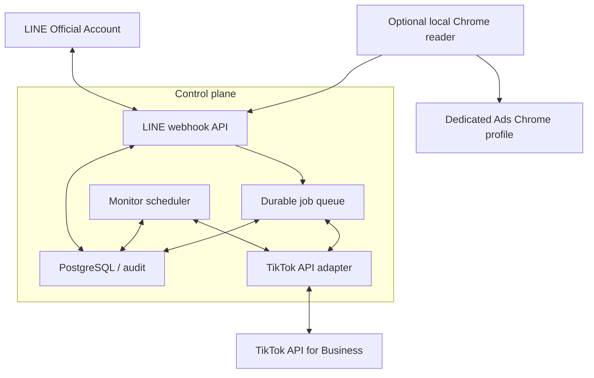

# Production architecture

## Recommended shape

MVP นี้รวม control API, monitor และ executor ไว้ใน Node process เดียว ใช้ SQLite พร้อม durable execution outbox/leases เพื่อ setup เร็วและทน process restart ก่อน production หลาย instance ควรเปลี่ยนเป็น PostgreSQL และ durable queue ภายนอกเพื่อไม่ผูกกับ disk เครื่องเดียว

## Why API-first

- ไม่ผูกกับ Chrome window/profile ที่เปิดอยู่
- advertiser ID และ campaign ID ตรวจได้ตรง ไม่ต้องเลือกชื่อจาก dropdown
- เหมาะกับ agency ที่บัญชีเดียวเข้าถึงหลาย ad accounts
- มี TikTok `request_id` สำหรับ audit
- UI เปลี่ยนแล้วระบบไม่พังทันที

Chrome จึงเป็น read-only fallback สำหรับ telemetry ที่ต้องสดกว่า report API ไม่ควรเก็บ password หรือ OTP และไม่ควรใช้ Chrome profile ประจำวันของผู้ปฏิบัติงาน

## Multi-account isolation

ทุก request ต้อง snapshot ค่าต่อไปนี้ก่อนส่ง LINE:

- `client_id`
- `advertiser_id`
- `store_id` / `store_authorized_bc_id` (nullable ก่อน observe ครั้งแรกเฉพาะ `observe-and-pin`)
- `campaign_id`
- `currency`
- `current_budget`
- `max_daily_budget`
- `authorized_line_user_ids`
- expiry/version

เมื่ออนุมัติ executor จะอ่าน TikTok ซ้ำและต้อง match advertiser, campaign, Shop identity ที่ pin แล้ว และ current budget ทั้งหมด ถ้าไม่ตรงให้ยกเลิก ไม่ทำ best-effort switch ไปบัญชีอื่น สำหรับ storeless onboarding ผู้ใช้ไม่ต้องกรอก Store ID; official campaign detail เป็นผู้ให้ค่าครั้งแรกก่อนอนุญาต API execution

สำหรับแคมเปญที่สร้างใหม่รายวัน config ใช้ dynamic selector แทน campaign ID คงที่ โดยล็อก advertiser, Shop, Business Center, TikTok account, ประเภท `LIVE`, สกุลเงิน และชื่อแคมเปญของวัน ระบบต้องพบ Active campaign ที่ตรงเพียงหนึ่งรายการ และ resolve ซ้ำทันทีก่อนเขียนงบ

หนึ่ง agency OAuth token route หลาย advertiser IDs ได้เฉพาะ IDs ที่อยู่ใน grant ของ token นั้น MVP เริ่มด้วย token เดียวและ startup validation ทุก mapping; หาก grant แยกกัน production adapter ต้องเลือก token จาก advertiser ID ผ่าน secret manager โดยห้ามรับชื่อ token หรือ advertiser ID จากข้อความ LINE

## Crash and duplicate behavior

- LINE events อาจมาซ้ำหรือสลับลำดับ: dedupe ด้วย `webhookEventId`
- LINE command ที่ actionable จะถูก normalize และเก็บแบบจำกัดข้อมูลพร้อม processing lease; worker อื่น replay ได้เมื่อ lease หมดอายุ
- ปุ่มอนุมัติอาจถูกกดซ้ำ: SQLite compare-and-set อนุญาต claim เดียว
- process อาจตายหลัง TikTok update แต่ก่อนบันทึก success: startup recovery อ่านงบจริงและปิดงานให้ถูกต้อง
- ใน production queue ต้องใช้ at-least-once delivery + idempotent execution โดย request ID เดิม

## Chrome fallback

Pilot ตรวจหน้า Ads แบบ read-only ผ่าน tab group `Ppan` ใน profile `Whalebuddy Ads` ได้แล้ว และตรวจพบ profile `Work` เชื่อมพร้อมกันด้วย การรองรับหลาย profile ต้องล็อก `browserProfile + tabGroup` ไว้ใน client config เพื่อป้องกันอ่านข้ามลูกค้า การเชื่อม browser ไม่ถือเป็นสิทธิ์แก้งบ และไม่แทน TikTok API grant

หากต้องใช้ fallback:

1. สร้าง/เลือก Chrome profile สำหรับ TikTok Ads โดยเฉพาะ
2. ให้ผู้ใช้ login และจัดการ 2FA ด้วยตนเองครั้งแรก
3. ติดตั้งตัวเชื่อมใน profile นั้น หรือรัน local Playwright/CDP worker ที่เชื่อม outbound ไป control plane
4. worker อ่านเฉพาะ BC/advertiser/TikTok account, ชื่อแคมเปญ, status, daily/total budget และ Cost/Net Cost; ห้ามสร้าง campaign ID ที่ UI ไม่ได้แสดง
5. approval และ budget mutation ยังใช้ control plane + TikTok API
6. ถ้า UI แสดง account/shop/currency ไม่ตรง config ให้หยุดทันที

ไม่ควร expose Chrome DevTools port หรือ Mac port ออกอินเทอร์เน็ตโดยตรง

ระหว่างยังไม่มี TikTok Developer App ให้ deploy ด้วย `CONTROL_PLANE_ONLY=true`: LINE webhook, health, pairing และ backend รับ signed Chrome telemetry ทำงานได้ แต่ monitor/execution/TikTok workers ถูกบังคับปิด Snapshot จึงบันทึก latest/audit เท่านั้นและไม่สร้างคำของบหรือเขียน TikTok

## Monitoring policy

ค่าเริ่มต้น:

- poll ทุก 5 นาที
- alert เมื่อ reported spend ≥ 70% ของ daily budget
- request หมดอายุ 15 นาที
- campaign หนึ่งมี active request ได้ครั้งเดียว
- mapping คงที่จำกัด target ด้วยทั้ง `maxDailyBudget` และ `maxIncreasePercent`; dynamic policy ต้องผ่าน hard cap และ policy revision ปัจจุบัน

Pilot `punpan_020` override ค่า default ดังนี้:

- ช่วง LIVE `06:00–23:00` Asia/Bangkok
- alert ที่ `80%`
- preset เพิ่ม `20%` จากงบปัจจุบัน และอนุญาต manual target
- hard cap `6,000 THB` มีผลตั้งแต่ `2026-07-19` จนกว่าจะออก policy revision ใหม่

ควรปรับ threshold ต่อ campaign จาก velocity จริงของ LIVE เนื่องจาก TikTok GMV Max report อาจหน่วงถึง 24 ชั่วโมง หากต้องป้องกัน budget stop แบบใกล้ real time ต้องใช้ native auto-budget ที่ตกลงเพดานไว้ หรือ dedicated Chrome reader ใน Ads profile
